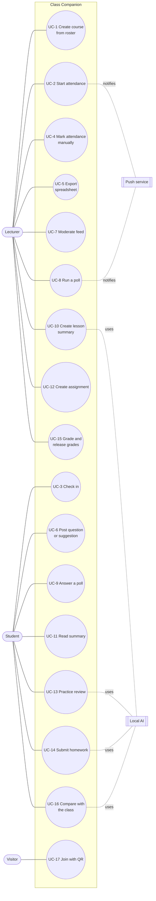

# Use Cases and User Stories: Class Companion

Requirement IDs refer to the [SRS](02-srs.md).

## 1. Actors

| Actor | Description |
|---|---|
| **Lecturer** | Owns courses; runs attendance, polls and the feed; publishes summaries; creates and grades assignments. |
| **Student** | On a course roster; checks in, posts, votes, answers polls, reads summaries, submits homework. |
| **Visitor** | Anyone with a course join link or QR code; becomes a Student by joining. |
| **Local AI** _(secondary)_ | whisper.cpp and the Ollama model on the lecturer's machine. |
| **Push service** _(secondary)_ | Apple / Google / Mozilla Web Push servers that deliver notifications. |

## 2. Use case diagram

## 3. User stories

| # | As a… | I want to… | So that… | Use case |
|---|---|---|---|---|
| US-1 | lecturer | create a course by uploading the student list I already have | I don't type 100 emails | UC-1 |
| US-2 | lecturer | open attendance from my laptop in one click | it doesn't eat into class time | UC-2 |
| US-3 | student | check in with one tap when I'm in the room | I don't queue for a sign-in sheet | UC-3 |
| US-4 | lecturer | be sure only students in the room can check in | a friend can't sign in for someone else | UC-3 |
| US-5 | lecturer | mark a student present or absent myself, even after class | I can fix a phone with no GPS or a cheater | UC-4 |
| US-6 | lecturer | export attendance and grades to Excel | I can submit them to the department | UC-5 |
| US-7 | lecturer | see who is under 70% attendance | I can talk to them before it's too late | UC-5 |
| US-8 | student | ask a question anonymously to my classmates | I'm not embarrassed to ask | UC-6 |
| US-9 | student | vote up a question someone else asked | the lecturer answers what most of us need | UC-6 |
| US-10 | lecturer | show the top questions on the projector | I answer them in class | UC-7 |
| US-11 | lecturer | ask "did you understand?" and see the answers live | I know whether to move on | UC-8 |
| US-12 | student | get a notification when a poll opens | I don't miss it | UC-9 |
| US-13 | lecturer | upload the lesson recording and get a draft summary | I publish a summary without writing it | UC-10 |
| US-14 | student who missed class | read a summary with topics and review questions | I can catch up | UC-11 |
| US-15 | lecturer | define criteria with points for an assignment | the AI and I grade by the same rubric | UC-12 |
| US-16 | student | get feedback on a draft before the deadline | I can fix it before it counts | UC-13 |
| US-17 | student | get feedback soon after submitting | I learn while the work is fresh | UC-14 |
| US-18 | lecturer | start from the AI's suggested points and adjust | grading is faster but still my decision | UC-15 |
| US-19 | lecturer | see what most of the class got wrong | I can address it in the next lesson | UC-15 |
| US-20 | student | see how my work compares with the class, anonymously | I know what others did that I missed | UC-16 |
| US-21 | visitor at a demo | scan a code and be in the course right away | I can try every feature on my phone | UC-17 |

## 4. Main use cases

### UC-2 Start attendance

| | |
|---|---|
| **Actor** | Lecturer |
| **Requirements** | ATT-1 – ATT-4, ATT-9 |
| **Precondition** | Logged in as the course's lecturer; device location allowed; HTTPS. |
| **Trigger** | Lecturer taps "התחלת נוכחות" (start attendance) on the course page. |
| **Postcondition** | An active session exists; rostered students are notified. |

**Main flow**
1. The system reads the device location and shows its accuracy.
2. When the accuracy is good enough, the lecturer confirms.
3. The system creates the session (centre, accuracy, the course's radius, an end time 15 minutes away) and sends a push notification to rostered students.
4. The system shows a live screen: count, dot grid of the class, remaining time, a QR code to the check-in page.

**Alternative flows**
- 1a. Accuracy worse than 100 m: the start button stays disabled with an explanation (move near a window, or wait).
- 1b. Location blocked: the system explains how to allow it.
- 3a. A session is already active for the course: the system opens it instead of creating a new one.

### UC-3 Check in

| | |
|---|---|
| **Actor** | Student |
| **Requirements** | ATT-5 – ATT-8 |
| **Precondition** | Student on the roster; session active. |
| **Trigger** | Student opens the notification or the course check-in page. |
| **Postcondition** | One attendance record (source `gps`) for the student in the session. |

**Main flow**
1. The student taps to allow location; the phone starts watching its position.
2. With each reading, the system asks the server whether the student is in range and shows the distance.
3. When in range, the student taps "אני כאן" (I'm here).
4. The server re-checks with the fresh reading (≤ 30 s old, accuracy ≤ 100 m, inside radius) and records the check-in.
5. The system confirms with the check-in time.

**Alternative flows**
- 2a. Out of range: the system shows the distance and keeps watching.
- 4a. Reading too old or imprecise: rejected with the reason; the student retries.
- 4b. Already checked in: the system shows the original time.
- 4c. Marked absent by the lecturer: rejected; the student is told to talk to the lecturer.
- 4d. Session closed meanwhile: rejected; "attendance is closed".

### UC-4 Mark attendance manually

**Actor:** Lecturer. **Requirements:** ATT-8.
1. The lecturer opens a live or past session and its roster.
2. They mark a student present or absent (or clear the mark).
3. The system saves it with source `manual`; statistics and the export update.

### UC-6 Post a question or suggestion

**Actor:** Student. **Requirements:** FEED-1 – FEED-3.
1. The student opens the course's questions tab, chooses question or suggestion, writes up to 500 characters, optionally ticks "anonymous to classmates", and sends.
2. The post appears in the feed for everyone; classmates can vote it up once.
3. When the lecturer replies or marks it answered, the author is notified (FEED-5).

**Alternative:** empty or too long text is rejected with a message.

### UC-8 Run a poll

**Actor:** Lecturer. **Requirements:** POLL-1 – POLL-7.
1. The lecturer writes the question, picks a type, options, optional correct answer and audience.
2. They open the poll (or save a draft). Students in the audience are notified.
3. Answers arrive; the lecturer watches results live, optionally on the projector view.
4. The lecturer closes the poll and optionally reveals results to students.

**Alternative:** 2a. Audience "present only" but no attendance session is active: the system refuses to open it.

### UC-10 Create a lesson summary

**Actor:** Lecturer; secondary: Local AI. **Requirements:** SUM-1 – SUM-5.
1. The lecturer uploads a recording and confirms the lesson date.
2. The system queues a background job and shows progress: extracting audio, transcribing, summarising.
3. The local model returns a structured summary; the system saves it as a draft.
4. The lecturer edits any part and publishes. Students are notified.

**Alternatives:** 2a. Unsupported or corrupt file: the job fails with a reason; the lecturer can retry. 2b. Server restarts mid-job: the job resumes.

### UC-13 Practice review

**Actor:** Student; secondary: Local AI. **Requirements:** ASG-6.
1. The student uploads a draft as "בדיקת טיוטה" (practice review).
2. The system extracts text and queues a review; the student is notified when it's ready.
3. The student reads the feedback per criterion (visible to them only).
4. Optionally, the student submits this draft as the final submission (continues in UC-14 step 3).

**Alternatives:** 1a. No practice reviews left: rejected. 2a. PDF without text: review skipped, not counted.

### UC-14 Submit homework

**Actor:** Student; secondary: Local AI. **Requirements:** ASG-2 – ASG-5.
1. The student uploads a PDF or ZIP.
2. The system extracts the text, stores the original file and, if the due date passed, records how late it is.
3. The submission replaces any earlier final submission; the AI review is queued.
4. The local model reviews each criterion; suggested points are computed from the verdicts.
5. The student is notified and sees the feedback (without points).

**Alternatives:** 1a. Wrong file type, empty file or over 50 MB: rejected with the reason. 2a. ZIP with no readable files: rejected. 2b. PDF with no text (scan): accepted, AI review skipped, lecturer checks by hand. 4a. Model unavailable: review fails; the lecturer can retry.

### UC-15 Grade and release grades

**Actor:** Lecturer. **Requirements:** ASG-7, ASG-8.
1. The lecturer opens a submission: AI feedback, suggested points per criterion, the extracted files.
2. They adjust points, add a comment, and save.
3. Optionally they generate a class overview or run the similarity check.
4. They release grades; graded students are notified and can see their grade.

### UC-16 Compare with the class

**Actor:** Student; secondary: Local AI. **Requirements:** ASG-9 – ASG-11.
**Precondition:** due date passed; the student's final submission reviewed; at least 5 classmates reviewed.
1. The student taps "השוואה לכיתה" (compare with the class).
2. The system builds (or reuses) anonymous class patterns from the reviews only.
3. It computes, per criterion, where the student is like most of the class, behind it, or ahead of it, and asks the model for a short summary.
4. The student sees the summary and the three lists.
5. After grades are released, the student also sees the grade distribution with their position.

**Alternatives:** 1a. Before the deadline: the button is replaced by "opens after the deadline". 1b. Fewer than 5 reviewed classmates: rejected with the reason.

### UC-17 Join with a QR code

**Actor:** Visitor. **Requirements:** CRS-5, CRS-6, CRS-7.
1. The lecturer shows the course's join screen (or demo screen) with a QR code.
2. The visitor scans it, enters first name, last name, email and optionally a password, and taps "הצטרפות" (join).
3. The system creates a student account (if the email is new), adds them to the roster, signs them in on that phone and opens the course.
4. Their name appears on the lecturer's join screen.

**Alternatives:** 2a. The email already has an account: the system asks for that account's password. 2b. Join link closed or code changed: "link not found or closed". 2c. Lecturer account email: refused.
