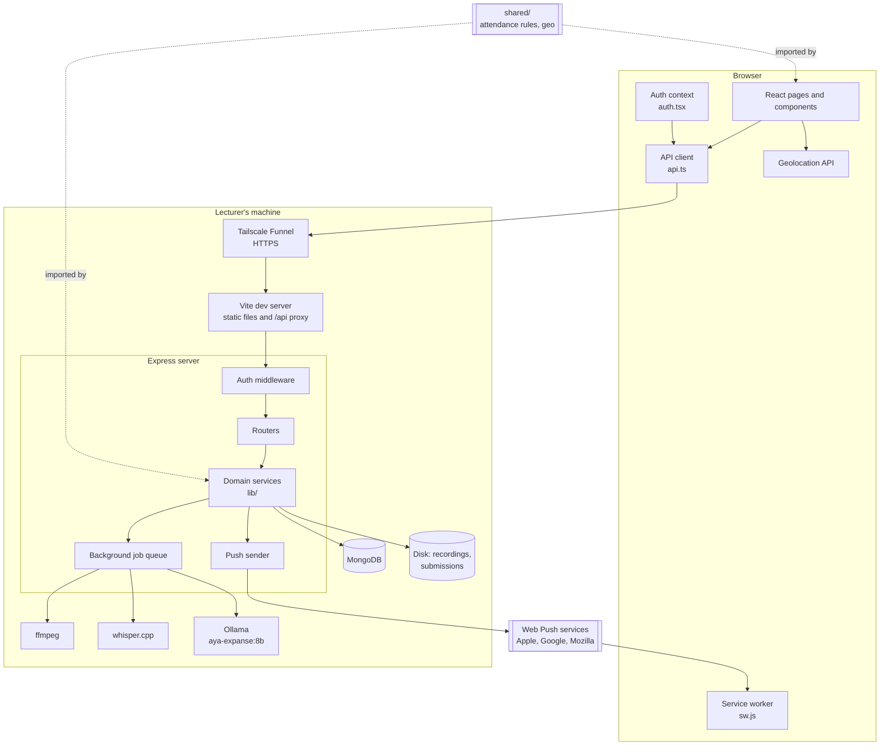
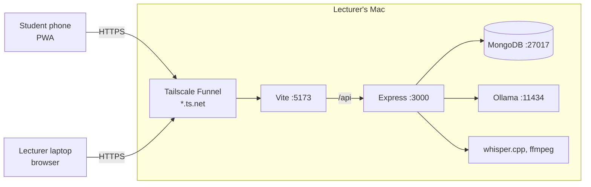

# Software Components: Class Companion

## 1. Architecture overview

Class Companion is a three-tier client/server system. A single-page React app (installable as a PWA) talks to an
Express REST API over HTTPS. The API stores data in MongoDB and files on disk, sends Web Push notifications, and
runs AI work in a background job queue that calls local tools: ffmpeg, whisper.cpp and Ollama. Code shared by both
tiers (attendance rules and distance maths) lives in `shared/`.

## 2. Client components (`client/src`)

| Component | Files | Responsibility |
|---|---|---|
| **App shell and routing** | `App.tsx`, `main.tsx`, `components/Layout.tsx`, `components/RequireAuth.tsx` | Routes for lecturer and student pages; redirects to login when there is no session; header, theme toggle. |
| **Auth context** | `auth.tsx` | Holds the logged-in user and token (in `localStorage`); `login`, `signup`, `logout`, `acceptSession` (join link). |
| **API client** | `api.ts` | `api()` wrapper over `fetch` with the token, JSON, typed responses and Hebrew error messages; `uploadFile` (XHR with progress) and `downloadFile`; all shared response types. |
| **Theme** | `theme.ts`, `index.css` | Light/dark tokens (Tailwind v4 `@theme`), applied without flashing on load. |
| **Design system** | `components/ui.tsx`, `Bento.tsx`, `DotGrid.tsx`, `icons.tsx`, `GradeChart.tsx` | Buttons, fields, toggles, bento tiles, the class dot grid, icons, the grade histogram. |
| **Home** | `pages/Courses.tsx`, `components/AgendaList.tsx` | Lecturer and student home pages: now tile, agenda, needs-action list, courses. |
| **Course management** | `NewCourse.tsx`, `CourseSettings.tsx`, `CourseStudents.tsx`, `CourseDashboard.tsx`, `CourseSchedulePage.tsx` | Create from roster file, settings and join link, roster, dashboard with statistics, weekly schedule and events. |
| **Attendance** | `LecturerAttendance.tsx`, `StudentCheckIn.tsx`, `CourseSessions.tsx`, `SessionDetail.tsx`, `components/LocationGate.tsx`, `SessionRoster.tsx`, `PhoneOnly.tsx` | Start and run a session, student check-in with live range, session history, manual marking, location permission handling. |
| **Feed** | `CourseFeed.tsx`, `FeedPresent.tsx` | Questions and suggestions; projector view. |
| **Polls** | `CoursePolls.tsx`, `PollPresent.tsx`, `components/PollEditor.tsx`, `PollResults.tsx`, `OpenPollBanner.tsx` | Create, run and answer polls; live results; projector view. |
| **Summaries** | `CourseSummaries.tsx`, `SummaryDetail.tsx` | Upload a recording, follow progress, edit and publish, read. |
| **Assignments** | `CourseAssignments.tsx`, `AssignmentDetail.tsx`, `SubmissionDetail.tsx` | Assignment editor; student submission, practice reviews, comparison, grade chart; lecturer submissions, grading, overview, similarity. |
| **Join and demo** | `JoinCourse.tsx`, `DemoScreen.tsx` | Public join form from a QR code; projector demo screen. |
| **Notifications** | `components/NotificationsCard.tsx`, `public/sw.js`, `public/manifest.webmanifest` | Subscribe the device to push; the service worker shows notifications and opens the right page on tap. |

## 3. Server components (`server/src`)

### 3.1 Entry and infrastructure

| Component | Files | Responsibility |
|---|---|---|
| **Bootstrap** | `index.ts`, `app.ts`, `db.ts`, `config.ts` | Connects to MongoDB, runs migrations and index sync, builds the Express app, mounts routers, resumes background jobs. Configuration from environment variables. |
| **Auth middleware** | `middleware/auth.ts`, `lib/auth.ts` | `requireAuth` verifies the JWT; `requireRole` checks lecturer/student; bcrypt hashing and token signing. |
| **Access control** | `lib/access.ts` | `findOwnCourse` (lecturer owns it) and `findAccessibleCourse` (lecturer owns it or student is on its roster). |
| **Job queue** | `lib/jobs.ts` | One in-process queue that runs AI jobs one at a time (`enqueueJob`), so the machine isn't overloaded. |
| **Push sender** | `lib/push.ts`, `models/PushSubscription.ts` | Stores device subscriptions; `notifyUsers`/`notifyCourseStudents` send Web Push with VAPID; removes expired subscriptions. |

### 3.2 Feature modules (router + services + models)

| Module | Router | Services (`lib/`) | Models |
|---|---|---|---|
| **Accounts** | `routes/auth.ts` | `roster.ts` (email checks, allowed domains) | `User` |
| **Courses** | `routes/courses.ts` | `roster.ts` (parse xlsx/csv), `stats.ts` (dashboard), `export.ts` (Excel) | `Course` |
| **Join link** | `routes/join.ts` | — | `Course`, `User` |
| **Attendance** | `routes/sessions.ts`, part of `courses.ts` | `sessions.ts` (auto-close, views), `validate.ts`, `shared/attendance.ts`, `shared/geo.ts` | `Session`, `Attendance` |
| **Feed** | `routes/posts.ts` | — | `Post` |
| **Polls** | `routes/polls.ts` | `polls.ts` (validate input and answers, aggregate results), `pollExport.ts` | `Poll`, `PollResponse` |
| **Schedule and home** | `routes/schedule.ts`, `routes/overview.ts` | `schedule.ts` (expand weekly slots and events), `recap.ts`, `time.ts` | `Course.schedule`, `CourseEvent` |
| **Lesson summaries** | `routes/summaries.ts` | `summaries/pipeline.ts`, `transcribe.ts`, `transcript.ts`, `summarize.ts`, `llm.ts` | `LessonSummary` |
| **Assignments** | `routes/assignments.ts` | `assignments/extract.ts`, `review.ts`, `similarity.ts` | `Assignment`, `Submission` |

### 3.3 AI pipeline components

| Component | File | Responsibility |
|---|---|---|
| **LLM client** | `lib/summaries/llm.ts` | `LlmClient` interface; `ollamaClient` calls Ollama with a JSON schema so answers are structured. Tests inject a fake client. |
| **Transcriber** | `lib/summaries/transcribe.ts` | ffmpeg extracts 16 kHz mono audio; whisper.cpp produces timestamped segments. |
| **Summariser** | `lib/summaries/summarize.ts`, `transcript.ts` | Splits long transcripts into chunks within the model's context, summarises, then merges into one structured summary. |
| **Submission extractor** | `lib/assignments/extract.ts` | Text from PDFs (`unpdf`) and from ZIPs (`yauzl`) with size and entry limits; skips binaries and junk folders. |
| **Reviewer** | `lib/assignments/review.ts` | Review prompt and schema per criterion; normalises verdicts into points; class overview; anonymous class patterns; comparison; grade statistics. |
| **Similarity** | `lib/assignments/similarity.ts` | 5-word shingles and Jaccard similarity between submissions. |

## 4. Interfaces between components

| From → To | Interface | Notes |
|---|---|---|
| Client → Server | REST/JSON over HTTPS, `Authorization: Bearer <JWT>` | Uploads are raw bodies (`application/octet-stream`) with the file name in the query string. |
| Server → MongoDB | Mongoose models | Unique indexes enforce one check-in per student per session and one final submission per student per assignment. |
| Server → Disk | `MEDIA_DIR`, `SUBMISSIONS_DIR` | Original recordings and submitted files. |
| Server → ffmpeg / whisper.cpp | Child processes | Paths from configuration. |
| Server → Ollama | HTTP `POST /api/chat` with `format: <JSON schema>` | Temperature 0.2. |
| Server → Push services | Web Push protocol (VAPID) | Only to endpoints of known push services. |
| Service worker → Client | `notificationclick` opens the URL in the payload | |

## 5. Main REST endpoints

| Area | Endpoints |
|---|---|
| Auth | `POST /api/auth/signup`, `POST /api/auth/login`, `GET /api/auth/me`, `GET /api/auth/signup-config` |
| Courses | `GET/POST /api/courses`, `POST /api/courses/preview`, `GET /api/courses/:id/settings`, `PATCH /api/courses/:id`, `POST/PUT /api/courses/:id/roster`, `DELETE /api/courses/:id/roster/:email`, `GET /api/courses/:id/students`, `GET /api/courses/:id/dashboard`, `GET /api/courses/:id/export` |
| Join | `GET/POST /api/join/:code`, `GET/POST /api/courses/:id/join`, `POST /api/courses/demo` |
| Attendance | `POST /api/courses/:id/sessions`, `GET /api/courses/:id/sessions[/active]`, `GET /api/sessions/:id`, `POST /api/sessions/:id/close`, `GET /api/sessions/:id/roster`, `PUT /api/sessions/:id/attendance`, `POST /api/sessions/:id/range`, `POST /api/sessions/:id/check-in` |
| Feed | `GET/POST /api/courses/:id/posts`, `POST /api/posts/:postId/vote`, `PATCH/DELETE /api/posts/:postId` |
| Polls | `GET/POST /api/courses/:id/polls`, `GET /api/courses/:id/polls/active`, `PUT/DELETE /api/polls/:pollId`, `POST /api/polls/:pollId/{open,close,reveal,duplicate}`, `PUT /api/polls/:pollId/response` |
| Schedule / home | `GET /api/me/agenda`, `GET /api/me/overview`, `GET/PUT /api/courses/:id/schedule`, `POST /api/courses/:id/events`, `PUT/DELETE /api/events/:eventId` |
| Summaries | `GET/POST /api/courses/:id/summaries`, `GET/PUT/DELETE /api/summaries/:summaryId`, `POST /api/summaries/:summaryId/{publish,retry}` |
| Assignments | `GET/POST /api/courses/:id/assignments`, `GET/PUT/DELETE /api/assignments/:aid`, `POST /api/assignments/:aid/{release,overview,submissions}`, `GET /api/assignments/:aid/similarity`, `GET /api/submissions/:sid[/file]`, `PUT /api/submissions/:sid/grade`, `POST /api/submissions/:sid/{review,submit,compare}` |
| Push | `GET /api/push/public-key`, `POST /api/push/{subscribe,unsubscribe,test}` |

## 6. Deployment

Planned: static client on Firebase Hosting; the API and AI stay on the lecturer's machine or a university server.
