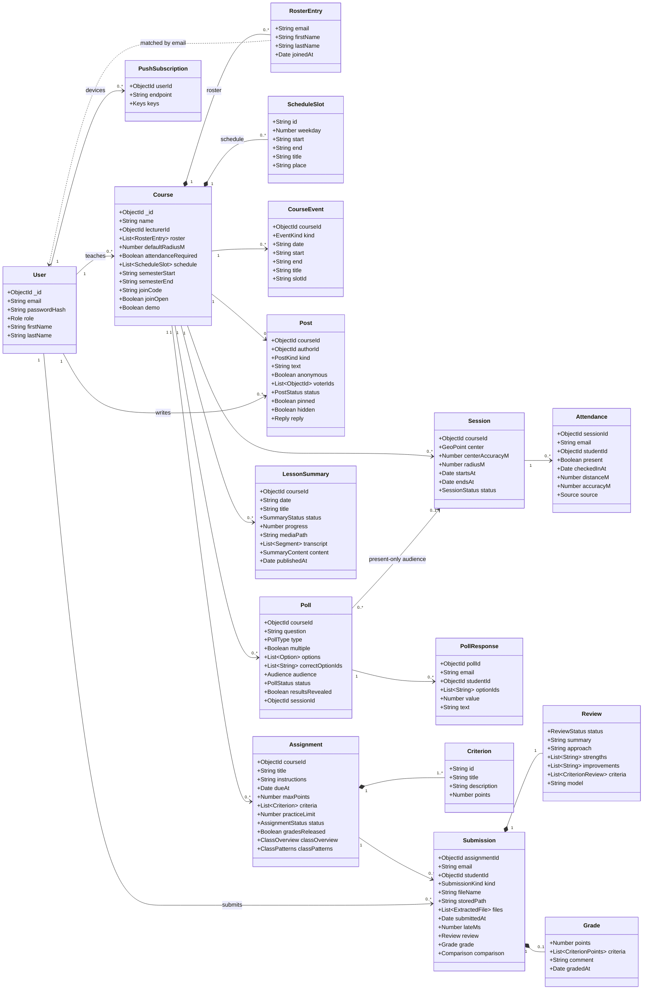
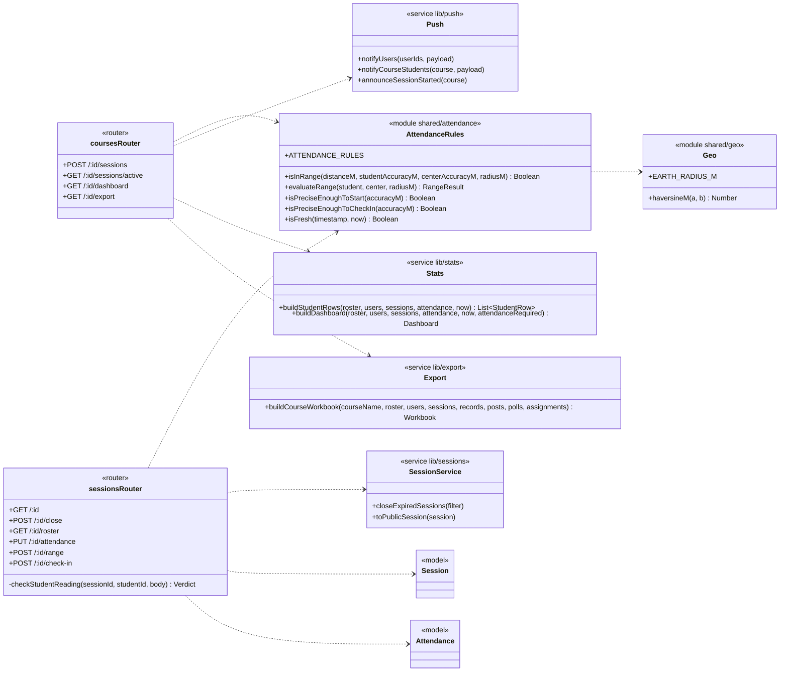
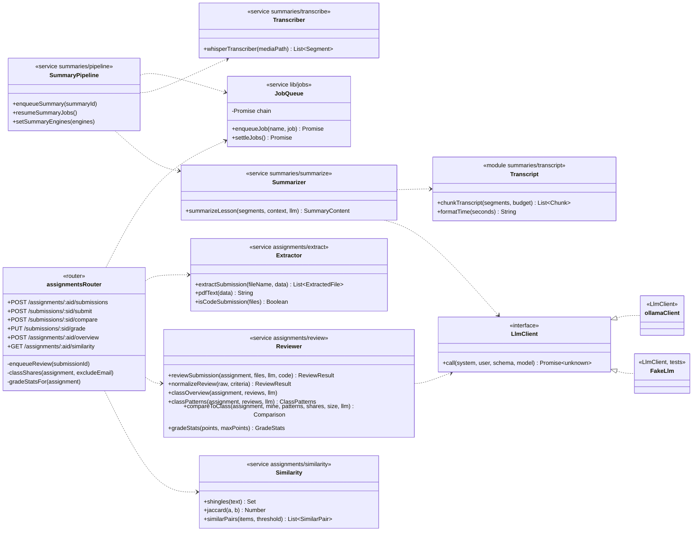
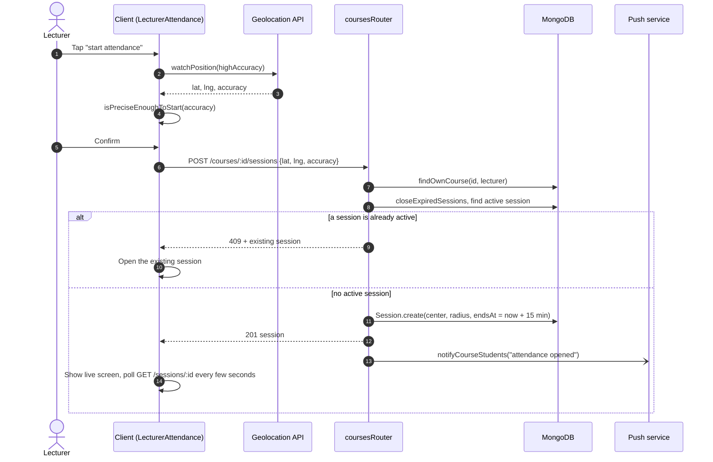
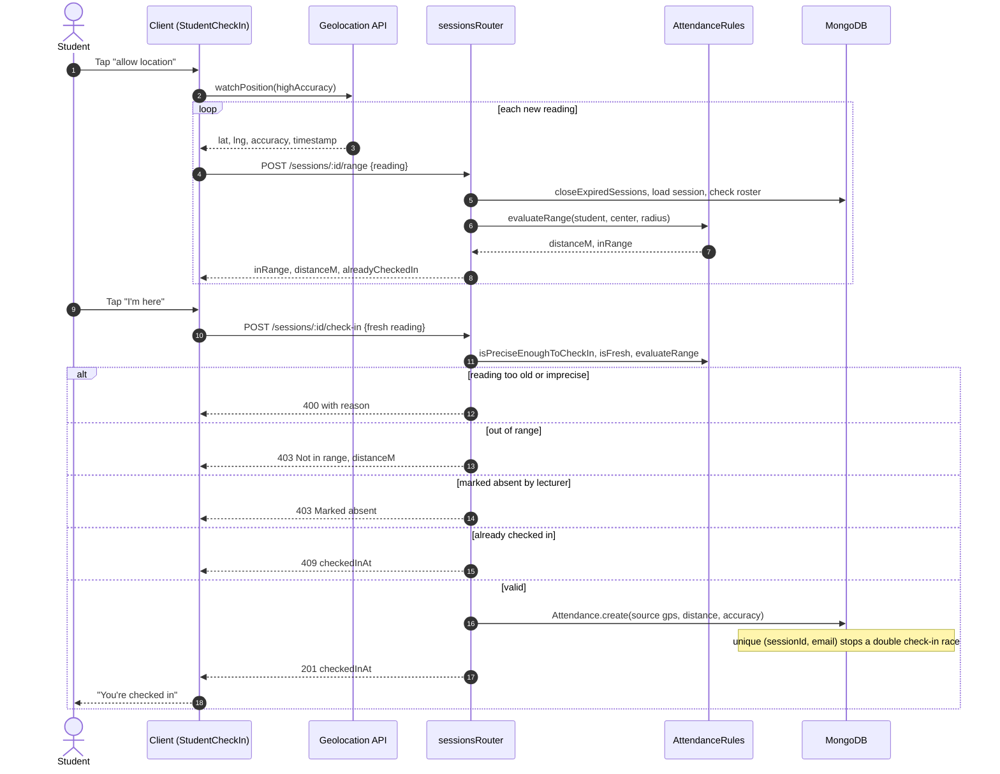
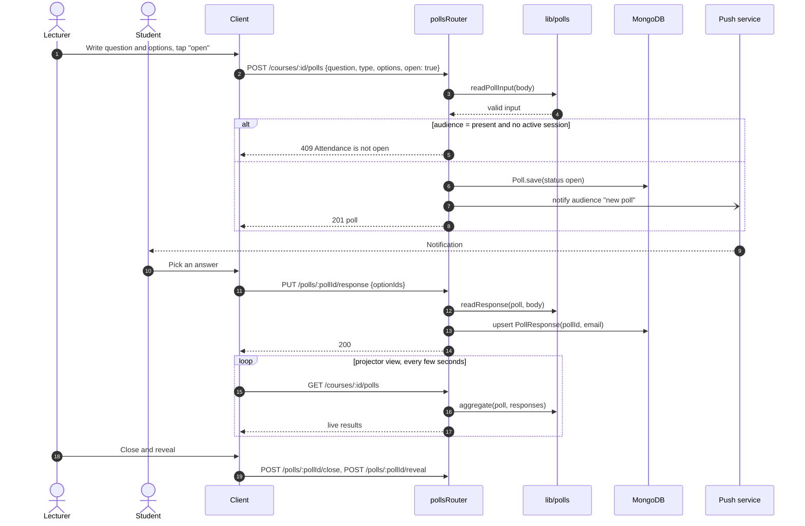
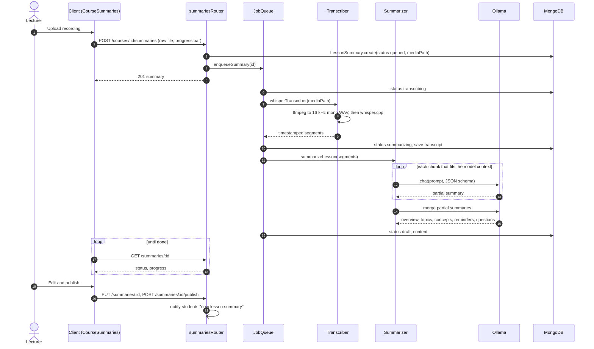
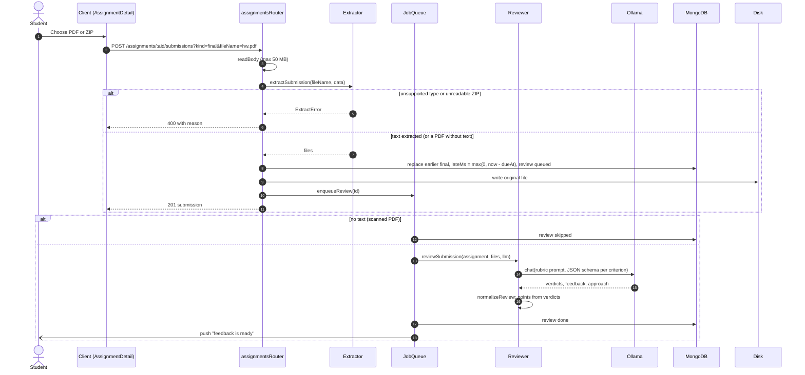
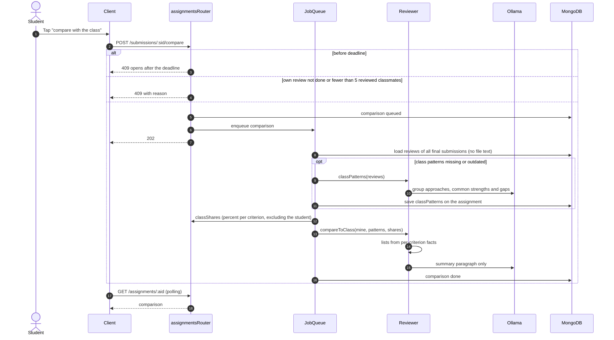
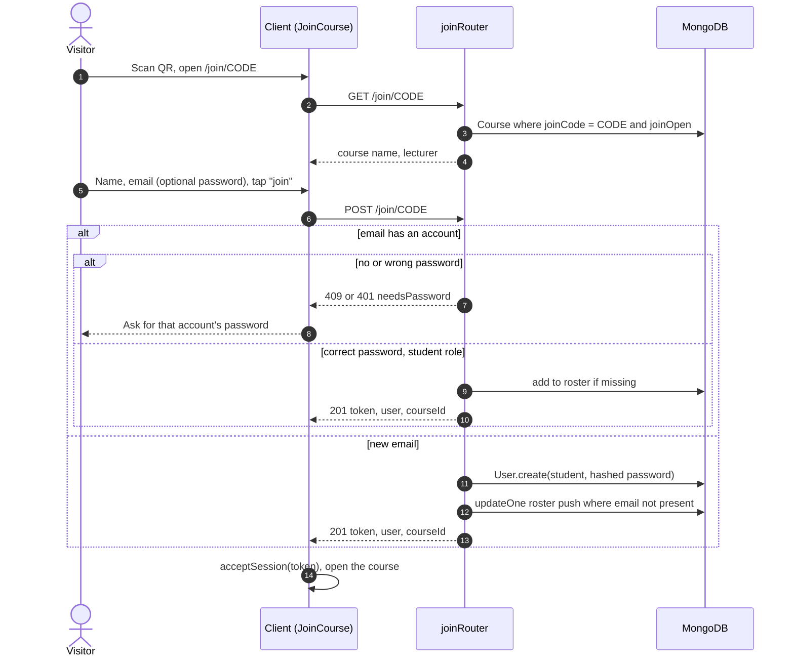

# Low-Level Design: Class and Sequence Diagrams

The server is written in TypeScript with Mongoose. Persistent entities are Mongoose models (shown as classes
with their fields); behaviour lives in routers and service modules (shown as classes with the `<<router>>`,
`<<service>>` or `<<module>>` stereotype and their main functions). Diagrams use Mermaid, which GitHub renders.

## 1. Class diagrams

### 1.1 Domain model

**Constraints enforced by indexes**
- `Attendance`: unique (`sessionId`, `email`): one record per student per session.
- `Submission`: unique (`assignmentId`, `email`) where `kind = final`: one final submission per student.
- `PollResponse`: unique (`pollId`, `email`): one answer per student per poll.
- `Course`: unique `joinCode` when set.
- `User`: unique `email`.

**Enumerations**

| Enum | Values |
|---|---|
| Role | `lecturer`, `student` |
| SessionStatus | `active`, `closed` |
| Source (attendance) | `gps`, `manual` |
| PostKind / PostStatus | `question`, `suggestion` / `open`, `answered` |
| PollType / PollStatus / Audience | `choice`, `yesno`, `scale`, `text` / `draft`, `open`, `closed` / `roster`, `present` |
| SummaryStatus | `queued`, `transcribing`, `summarizing`, `draft`, `published`, `failed` |
| SubmissionKind | `final`, `practice` |
| ReviewStatus | `queued`, `running`, `done`, `failed`, `skipped` |
| EventKind | `extra`, `cancelled`, `office`, `meeting`, `exam`, `other` |

### 1.2 Attendance: services and rules

### 1.3 AI features: summaries and homework review

`LlmClient` is the seam that keeps AI features testable: production code receives `ollamaClient`, while tests
inject a fake through `setReviewLlm` / `setSummaryEngines`, so tests are fast and deterministic.

## 2. Sequence diagrams

### 2.1 Start attendance (UC-2)

### 2.2 Student check-in (UC-3)

### 2.3 Run and answer a poll (UC-8, UC-9)

### 2.4 Lesson summary from a recording (UC-10)

### 2.5 Submit homework and AI review (UC-14)

### 2.6 Compare with the class (UC-16)

### 2.7 Join a course with a QR code (UC-17)

